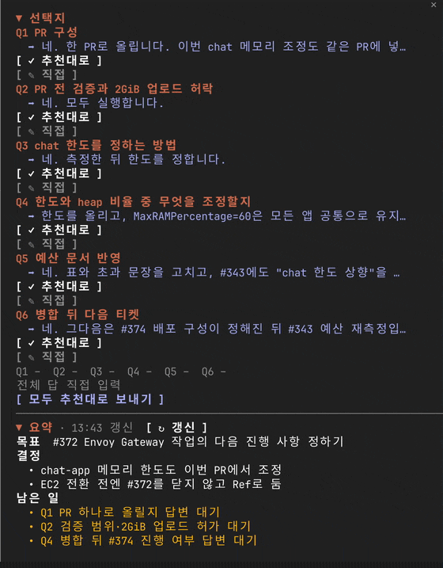
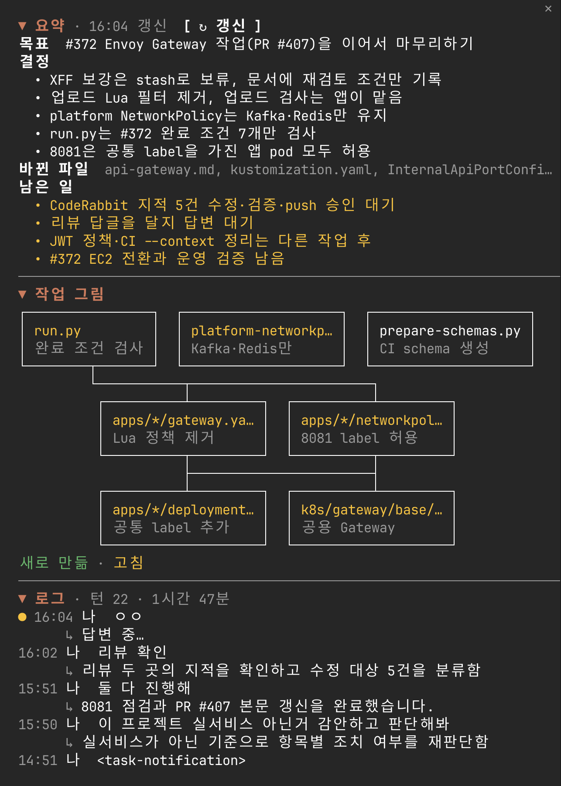

[한국어](README.md) | **English**

# sidecar

[](https://github.com/kaameo-lab/sidecar/releases/latest)
[](LICENSE)
[](https://claude.com/blog/claude-code-mods)

**A pane that sits beside Claude Code.** When Claude offers options or asks questions, answer them with a button. See at a glance what this session decided and what is left, how the files you touched fit together, and what each turn did.

> **Language.** The pane's text and its model prompts are Korean, so the log lines and the summary come out in Korean. Option detection is tuned for Korean answers: lettered lists (`a)`, `b)`), `Q1 - …` blocks and lists near a `?` are taken in any language, but the cue words that offer a list without a `?` ("중에서", "골라", …) are Korean.

<p align="center">
  
</p>

## Install

Inside Claude Code:

```
/plugin install sidecar --marketplace kaameo-lab/sidecar
/reload-plugins
/sidecar
```

<details>
<summary><strong>From a terminal, or from a clone</strong></summary>

```sh
claude plugin marketplace add kaameo-lab/sidecar
claude plugin install sidecar@kaameo-lab
```

To try it for one session without installing:

```sh
git clone https://github.com/kaameo-lab/sidecar
claude --plugin-dir ./sidecar
```

Update with `claude plugin update sidecar@kaameo-lab`, remove with `claude plugin uninstall sidecar@kaameo-lab`.

</details>

**Requirements**: checked with Claude Code 2.1.312. Mods are an early access feature of Claude Code, so their API may change between versions. Tracking changed files needs git (without it, only files changed by the Edit and Write tools are counted).

## What you see

<!-- Full screen: docs/media/docked-session.png -->

| Section | What it shows | When it changes |
| --- | --- | --- |
| **선택지** (options) | The options and questions in the last answer, as buttons. Pressing one sends it as if you had typed it. A recommended answer is marked `✓추천`. | Each time Claude finishes an answer |
| **요약** (summary) | The session's goal, what was decided, what is left, and the files changed this session | Every 5 turns, or when you press `↻ 갱신` |
| **작업 그림** (diagram) | The files and modules this session created (green) or changed (yellow), as boxes and lines | When the summary is refreshed |
| **로그** (log) | One row per turn: what you asked and what Claude did. Press a row to unfold its detail lines. | Each time a turn ends |

<p align="center">
  
</p>

The pane opens when an interactive session starts and when an answer holds options. Its colours follow your Claude Code theme.

## Usage

| Command or key | What it does |
| --- | --- |
| `/sidecar` | Open the pane |
| `/sidecar close` | Close the pane. It stays closed, even when an answer holds options, until `/sidecar` opens it again. |
| `ctrl+x tab` | Move focus to the pane |
| `a` `b` `c` … | (With focus in the pane) pick a simple option |
| Press a section title | Fold or unfold the section |

### Formats taken as options

| Format | Example | Answer sent |
| --- | --- | --- |
| Lettered list | `a) 세션 쿠키` `b) JWT` | `b) JWT` |
| Numbered list | When a `?` is nearby, or the line right before offers it ("다음 중에서 고르시면", "방법은 두 가지") | `1) …` |
| Q block | `❓ Q1 - title: question` with `➡️ recommended answer` and `a) b)` under it | The `Q1: …` lines, sent together |
| Numbered questions | `1. 닫을까요?` `2. 만들까요?` closing the answer | The `1번: …` lines, sent together |
| Lettered headings | A paragraph under each `**A. option**`, ending with "어느 쪽으로 할까요?" | `a) option` |

Q blocks and numbered questions are answered one by one, by picking an option or by pressing `✎ 직접` and typing in the field that opens right under that question, and then sent together. Text you were typing stays as that question's answer when you move on to another. The bottom field is a **note to add** (덧붙일 말): what you write there goes out under the chosen answers after a blank line, and under the chosen option for simple options too. Below the dotted line after the last question, the text that will be sent is previewed in a bordered box, followed by a status line per question, the note field and the send buttons. When there are recommended answers, "모두 추천대로 보내기" (send all as recommended) works too. An option cut short by the pane's width sends only its key (`b`), so no text you did not see goes out in your name.

## What it touches

| What it does | How |
| --- | --- |
| Writes one log line per turn | One Haiku call (`$.model.complete`) |
| Writes the summary and the diagram | One fork of the current session (`$.model.fork`) every 5 turns, or on `↻ 갱신` |
| Finds the changed files | `git stash create`, `git diff --name-only`, `git ls-files --others`. It does not change the work tree, the index or the stash list. |
| Saves and restores the pane | Per session, the log (last 30 rows), the summary and the changed files, in a store of sidecar's own inside the Claude Code settings folder. Only the latest 20 sessions are kept. |
| Sends answers | With `$.prompt.submit`, only when you press a button. |

Model calls go out through the Claude Code account you are using, and no other network requests are made. `claude plugin validate .` shows exactly what it hooks and calls.

## What is a guess

- **Option detection is a heuristic.** It misses what does not fit the formats above, and rarely takes a list of steps as options. The formats were measured against local conversation logs (some two thousand answers), and only the ones with few false hits went in.
- **The summary and the diagram are written by a model.** The changed files come from tool calls and git, but the goal, the decisions, and the boxes and lines are the model's reading of the conversation.

## Troubleshooting

**The pane does not open.** Run `/sidecar` after `/reload-plugins`. In a narrow terminal Claude Code may not place a pane it opens by itself; `/sidecar` always opens it.

**Options are not picked up.** Check that the answer fits the [formats table](#formats-taken-as-options). If it fits and still is not picked up, please open an [issue](https://github.com/kaameo-lab/sidecar/issues) with that answer.

**The pane is empty after a resume.** A session started fresh with `claude --resume` is restored. After `/clear` or `/resume` inside Claude Code the pane starts empty. Sessions from before 0.4.0 have nothing saved.

**The changed files are empty.** Outside a git repository only files changed by the Edit and Write tools are counted.

## Layout

| File | What it holds |
| --- | --- |
| [`hooks/register.tsx`](hooks/register.tsx) | Event hooks, state, saving and restoring, drawing the pane |
| [`hooks/parse.ts`](hooks/parse.ts) | Finding options and questions in an answer |
| [`hooks/digest.ts`](hooks/digest.ts) | The log and summary prompts, and reading what the model returns |
| [`hooks/diagram.ts`](hooks/diagram.ts) | Drawing the diagram as boxes and lines (a tree when narrow) |
| [`hooks/width.ts`](hooks/width.ts) | Width counting that takes Hangul as two cells |
| [`tests/`](tests) | Tests of the pure functions, and pane tests drawn on terminal and desktop |

## Development

```sh
claude --plugin-dir .            # load it; reload after changes
claude plugin test .
claude plugin validate .
npx -p typescript tsc --noEmit -p .
```

Rules and structure are in [CLAUDE.md](CLAUDE.md). Bugs and suggestions go to [GitHub Issues](https://github.com/kaameo-lab/sidecar/issues).

## License

[MIT](LICENSE)
