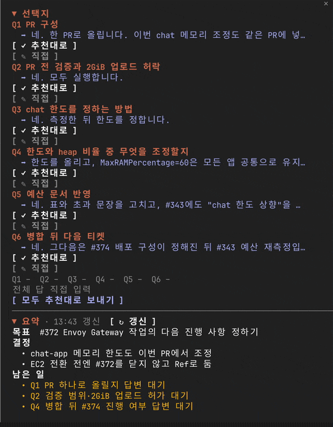
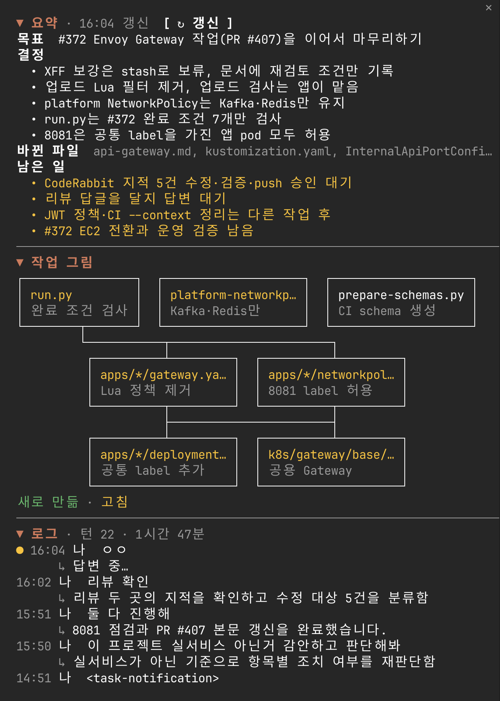

**한국어** | [English](README.en.md)

# sidecar

[](https://github.com/kaameo-lab/sidecar/releases/latest)
[](LICENSE)
[](https://claude.com/blog/claude-code-mods)

**Claude Code 옆에 붙는 pane.** Claude가 선택지나 질문을 내놓으면 버튼으로 바로 답하고, 이 세션에서 정한 것과 남은 일, 손댄 파일의 구조, 턴별로 한 일을 한눈에 봅니다.

<p align="center">
  
</p>

## 설치

Claude Code 안에서:

```
/plugin install sidecar --marketplace kaameo-lab/sidecar
/reload-plugins
/sidecar
```

<details>
<summary><strong>터미널에서, 또는 clone해서</strong></summary>

```sh
claude plugin marketplace add kaameo-lab/sidecar
claude plugin install sidecar@kaameo-lab
```

설치하지 않고 한 세션에서만 써 보려면:

```sh
git clone https://github.com/kaameo-lab/sidecar
claude --plugin-dir ./sidecar
```

업데이트는 `claude plugin update sidecar@kaameo-lab`, 제거는 `claude plugin uninstall sidecar@kaameo-lab`입니다.

</details>

**사전 요구사항**: Claude Code 2.1.312에서 확인했습니다. mod는 Claude Code의 early access 기능이라 API가 버전마다 바뀔 수 있습니다. 바뀐 파일 추적에는 git이 필요합니다(없으면 Edit·Write 도구로 바뀐 파일만 셉니다).

## 보이는 것

<!-- 전체 화면: docs/media/docked-session.png -->

| 섹션 | 보여 주는 것 | 언제 바뀌나 |
| --- | --- | --- |
| **선택지** | 마지막 답에 있는 선택지와 질문을 버튼으로. 누르면 사용자가 입력한 것처럼 보내집니다. 추천 답에는 `✓추천` 표시가 붙습니다. | Claude가 답을 마칠 때마다 |
| **요약** | 세션의 목표, 지금 하는 일, 정한 것, 남은 일, 이 세션에 바뀐 파일 | 3턴마다, 또는 `↻ 갱신`을 누를 때 |
| **작업 그림** | 두 탭으로 봅니다. **작업 흐름**은 이 세션에서 한 작업을 순서대로 `[끝]` `[진행]` `[대기]`와 함께, 작업마다 바꾼 것과 지금 상태를 보여 줍니다(최근 6개). **파일**은 만들거나(초록) 고친(노랑) 파일을 상자와 선으로, 파일마다 이번에 바꾼 것을 보여 줍니다. | 요약을 갱신할 때 |
| **로그** | 턴마다 한 줄: 무엇을 물었고 Claude가 무엇을 했는지. 누르면 자세한 줄이 펼쳐집니다. | 턴이 끝날 때마다 |

<p align="center">
  
</p>

pane은 대화형 세션이 시작될 때와 답에서 선택지를 찾았을 때 열립니다. 색은 사용 중인 Claude Code 테마를 따릅니다.

## 사용

| 명령·키 | 하는 일 |
| --- | --- |
| `/sidecar` | pane 열기 |
| `/sidecar close` | pane 닫기. `/sidecar`로 다시 열 때까지 선택지가 나와도 열리지 않습니다. |
| `ctrl+x tab` | pane으로 포커스 옮기기 |
| `a` `b` `c` … | (포커스가 pane에 있을 때) 단순 선택지 고르기 |
| 섹션 제목 누르기 | 섹션 접기·펴기 |

### 선택지로 인식하는 형식

| 형식 | 예 | 보내는 답 |
| --- | --- | --- |
| 문자 목록 | `a) 세션 쿠키` `b) JWT` | `b) JWT` |
| 숫자 목록 | 근처에 `?`가 있거나, 바로 앞 줄이 "다음 중에서 고르시면", "방법은 두 가지"일 때 | `1) …` |
| Q 블록 | `❓ Q1 - 제목: 질문` 아래 `➡️ 추천 답`과 `a) b)` | `Q1: …` 줄을 모아 한 번에 |
| 번호 질문 목록 | 답 끝의 `1. 닫을까요?` `2. 만들까요?` | `1번: …` 줄을 모아 한 번에 |
| 문자 제목 | `**A. 안**` 아래 설명 문단, 끝에 "어느 쪽으로 할까요?" | `a) 안` |

Q 블록과 번호 질문은 질문마다 고르거나, `✎ 직접`을 눌러 그 질문 바로 아래 생기는 입력창에 적은 뒤 한 번에 보냅니다. 적다가 다른 질문으로 넘어가도 적은 글이 그 질문의 답으로 남습니다. 맨 아래 칸은 **덧붙일 말**입니다. 적으면 고른 답 아래에 빈 줄을 두고 붙어서 함께 보내지고, 단순 선택지에서도 고른 선택지 아래에 붙습니다. 마지막 질문 아래 점선 밑에는 실제로 보낼 글이 테두리 상자에 미리 보이고, 그 아래에 질문별 상태 줄, 덧붙일 말 칸, 보내기 버튼이 있습니다. 추천 답이 있으면 "모두 추천대로 보내기"도 됩니다. pane 폭에 잘려 보인 선택지는 글자 대신 키(`b`)만 보냅니다. 보이지 않은 글자가 사용자 이름으로 나가지 않게 하려는 것입니다.

## 접근 범위

| 하는 일 | 어떻게 |
| --- | --- |
| 턴마다 로그 한 줄 만들기 | Haiku 호출 한 번(`$.model.complete`). 그 턴의 요청 첫 줄과 답을 보냅니다. |
| 요약과 작업 그림 만들기 | 3턴마다, 또는 `↻ 갱신` 때 현재 세션 fork 한 번(`$.model.fork`). fork한 대화에 마지막 답과 바뀐 파일 목록을 붙인 요약 프롬프트를 보냅니다. |
| 바뀐 파일 찾기 | `$.process.run`으로 `git`만 실행합니다. [아래 표](#실행하는-명령)의 다섯 가지뿐이고, 출력은 pane과 아래 store에만 씁니다. 작업 트리, 인덱스, stash 목록은 바꾸지 않습니다. |
| pane 저장과 복원 | 세션별로 로그(최근 30줄), 요약, 바뀐 파일을 Claude Code 설정 폴더 안의 sidecar 전용 store에 저장합니다. 최근 20개 세션만 남깁니다. 세션 id(`$.session.id`)는 이 저장 키(`session:<id>`)로만 씁니다. |
| 답 보내기 | 버튼을 누를 때만 `$.prompt.submit`으로 보냅니다. 보내는 글은 미리보기 상자에 보이는 그대로, 고른 선택지나 적은 답과 덧붙일 말뿐입니다. 세션 id, 파일 목록, 로그나 요약은 넣지 않습니다. |

모델 호출은 사용 중인 Claude Code 계정으로 나가고, 그 밖의 네트워크 요청은 하지 않습니다. git도 이 컴퓨터 안에서만 돕니다. `claude plugin validate .`가 무엇을 hook하고 호출하는지 그대로 보여 줍니다.

### 실행하는 명령

세션이 시작할 때, 메인 대화의 턴이 끝날 때, 요약을 만들기 전에 아래 명령을 실행합니다. 하나에 5초까지 기다리고, git 저장소가 아니거나 실패하면 그냥 넘어갑니다.

| 명령 | 왜 |
| --- | --- |
| `git rev-parse --show-toplevel` | 저장소 루트 찾기 |
| `git ls-files --others --exclude-standard --full-name -z` | 추적하지 않는 파일. 시작할 때 이미 있던 것은 빼고, 새로 생긴 것은 셉니다. |
| `git stash create` | 시작할 때의 작업 트리를 커밋 객체로만 남깁니다. 어떤 ref도 가리키지 않아 stash 목록에 생기지 않습니다. |
| `git rev-parse HEAD` | 커밋하지 않은 변경이 없으면 HEAD를 기준으로 |
| `git diff --name-only --no-renames -z <기준>` | 기준 이후 바뀐 파일 이름. `<기준>`은 위 두 명령이 준 커밋 id입니다. |

### hook

| 이벤트 | 하는 일 |
| --- | --- |
| `session.start` | `/sidecar` 명령 등록, 저장된 pane 복원, git 기준 잡기, pane 열기 |
| `session.end` | pane 저장. `/clear`나 `/resume`이면 pane을 비웁니다. |
| `ui.close` | 사람이 sidecar pane을 닫으면 닫힘을 기억합니다. `/sidecar`로 열 때까지 자동으로 열지 않습니다. |
| `command.run` (`/sidecar`) | pane 열기, `close`면 닫기 |
| `prompt.submit` | 사람이 직접 보낸 프롬프트면 pane의 "보냄" 표시를 지웁니다. |
| `turn.start` | 메인 대화의 턴마다 로그 행 추가 |
| `tool.call` (Edit, Write, NotebookEdit) | 성공한 호출이 바꾼 파일 경로를 기록 |
| `turn.complete` | 답에서 선택지 찾기, 로그 한 줄, 바뀐 파일 찾기, 3턴마다 요약 |
| `ui.render` (`Pane`) | sidecar pane 그리기 |

어느 hook도 이벤트나 다른 코드의 호출을 막거나 바꾸지 않고 그대로 넘깁니다. `command.run`과 `ui.render`는 sidecar 자신의 명령과 pane에만 답합니다.

## 추정인 것

- **선택지 인식은 휴리스틱입니다.** 위 형식에 맞지 않으면 놓치고, 드물게 단계 목록을 선택지로 잡습니다. 형식은 로컬 대화 기록(답변 2천여 개)으로 재 보고 오탐이 적은 것만 넣었습니다.
- **요약과 작업 그림은 모델이 쓴 것입니다.** 바뀐 파일 목록은 도구 호출과 git에서 오지만, 목표와 결정, 상자와 선은 모델이 대화를 읽고 정리한 것입니다.

## 문제 해결

**pane이 안 열려요.** `/reload-plugins` 뒤 `/sidecar`를 실행하세요. 터미널이 좁으면 Claude Code가 자동으로 여는 pane을 자리에 앉히지 않을 수 있습니다. `/sidecar`로는 언제든 열립니다.

**선택지가 안 잡혀요.** 위 [형식 표](#선택지로-인식하는-형식)에 맞는지 보세요. 맞는데도 안 잡히면 그 답변을 붙여 [issue](https://github.com/kaameo-lab/sidecar/issues)로 알려 주세요.

**resume했더니 pane이 비어 있어요.** `claude --resume`으로 새로 띄운 세션은 복원됩니다. Claude Code 안에서 `/clear`나 `/resume`을 하면 pane은 빈 상태로 시작합니다. 0.4.0 이전 세션은 저장된 기록이 없습니다.

**바뀐 파일이 비어 있어요.** git 저장소가 아니면 Edit·Write 도구로 바뀐 파일만 셉니다.

## 구조

| 파일 | 내용 |
| --- | --- |
| [`hooks/register.tsx`](hooks/register.tsx) | 이벤트 hook, 상태, 저장과 복원, pane 그리기 |
| [`hooks/parse.ts`](hooks/parse.ts) | 답에서 선택지와 질문 찾기 |
| [`hooks/digest.ts`](hooks/digest.ts) | 로그·요약 프롬프트와 모델 답 해석 |
| [`hooks/diagram.ts`](hooks/diagram.ts) | 작업 그림을 상자와 선(좁으면 트리)으로 그리기 |
| [`hooks/width.ts`](hooks/width.ts) | 한글을 두 칸으로 세는 폭 계산 |
| [`tests/`](tests) | 순수 함수 테스트와, terminal·desktop에 그려 보는 pane 테스트 |

## 개발

```sh
claude --plugin-dir .            # 불러오기, 고치면 다시 불러옵니다
claude plugin test .
claude plugin validate .
npx -p typescript@5.6.3 tsc --noEmit -p .
```

규칙과 구조는 [CLAUDE.md](CLAUDE.md)에 있습니다. 버그와 제안은 [GitHub Issues](https://github.com/kaameo-lab/sidecar/issues)로 받습니다.

## 라이선스

[MIT](LICENSE)
